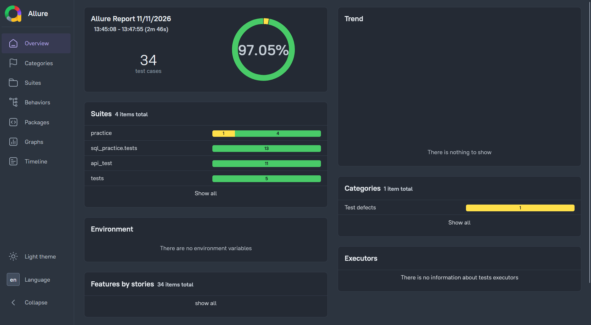

# QA Automation Portfolio
[](https://github.com/aruncorpo/qa-automation-portfolio/actions/workflows/tests.yml)

A hands-on test automation project using Python, Selenium WebDriver, pytest, sqlite3 and Requests. This repository contains browser-based UI tests, API tests and SQL tests, with reusable components and automated test execution.

## Tech Stack

- **Python** — programming language
- **Selenium WebDriver** — browser automation
- **pytest** — test execution, fixtures, and parametrization
- **Requests** — HTTP API testing
- **SQLite3** — Database testing
- **Git and GitHub** — version control
- **CSV** — data-driven test inputs
- **Allure** — test reporting

## Project Structure

```text
qa-automation-portfolio/
├── api_test/       # API Testing
├── data/           # Test data
├── docs/           # Reports
├── pages/          # Page Object Modules
├── practice/       # Selenium practice exercises
├── sql_practice/   # SQL Testing
├── tests/          # Tests
├── utils/          # Reusable utilities
├── conftest.py     # Shared pytest fixtures
├── data_prep.py    # Test data preparation
└── README.md
```

## UI Test Automation

The UI tests use Selenium WebDriver and pytest to automate workflows on the SauceDemo demo application.

The project includes:
- Page Object Model (POM) for separating page interactions from test logic
- Reusable browser and page methods
- CSV-driven login test data
- Explicit waits for browser interactions
- pytest fixtures for setup and teardown
- Failure screenshots through pytest hooks and Allure integration

## API Test Automation

The API tests use Requests and pytest against JSONPlaceholder and httpbin test endpoints.

Coverage includes:
- GET, POST, PUT, PATCH, and DELETE requests
- HTTP status and JSON response validation
- Query parameters
- Successful and unsuccessful authentication scenarios
- Request timeouts
- Reusable API client with a persistent Requests session

**Note:** These API tests run against public practice services (such as JSONPlaceholder). JSONPlaceholder simulates write operations; created or updated resources are not permanently stored.

## Setup

### Prerequisites

- Python version 3.12.0+ installed
- Google Chrome installed for UI tests
- Git installed

### Installation

Clone the repository:

```powershell
git clone https://github.com/aruncorpo/qa-automation-portfolio.git
cd qa-automation-portfolio
```

Create and activate a virtual environment on Windows:

```powershell
python -m venv .venv
.\.venv\Scripts\Activate.ps1
```

Install dependencies:

```powershell
python -m pip install -r requirements.txt
```

### Running Tests

Run all collected tests:

```powershell
python -m pytest
```

Run all the  tests in headless mode:
```powershell
python -m pytest --headless
```

Run API tests:

```powershell
python -m pytest api_test -v
```

Run SQL tests:

```powershell
python -m pytest sql_practice -v
```

Run UI tests:

```powershell
python -m pytest tests -v
```

Run tests with Allure result collection:

```powershell
python -m pytest --alluredir=allure-results
```

The final Allure HTML report requires the Allure command-line tool to be installed separately.

## Learning Goals

This project is part of my ongoing development in software testing and automation, with a focus on maintainable test frameworks, reliable test execution, and practical UI testing, API testing and SQL testing.


## Allure report


